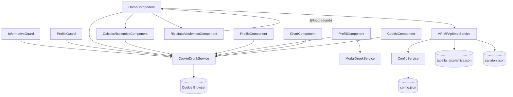

# drunk-io — Analisi Tecnica

> **Versione**: 1.0  
> **Data**: 2025  
> **Riferimento**: `docs/requirements/drunk-io-codebase-baseline.md`, `docs/architecture/drunk-io-system-architecture.md`

---

## 1. Decomposizione Feature per Componente

### 1.1 HomeComponent
**Feature**: Orchestrazione del flusso principale di calcolo BAC.

| Responsabilità | Descrizione |
|---|---|
| Caricamento dati | Invoca `APIMFApiImplService` per `tabella_alcolemica.json` e `sanzioni.json` all'init |
| State management locale | Mantiene `tabellaAlcolemica`, `sanzioni`, `tassoCalcolato`, flag `showRisultato` |
| Orchestrazione child | Passa tabella a `CalcoloAlcolemicoComponent`; passa tasso + sanzioni a `RisultatoAlcolemicoComponent` |
| Evento BAC | Riceve `tassoOut` da `CalcoloAlcolemicoComponent` e passa a `RisultatoAlcolemicoComponent` |

**Tipo**: Smart Component  
**Dipendenze**: `APIMFApiImplService`, `CookieDrunkService` (profilo corrente)

---

### 1.2 CalcoloAlcolemicoComponent
**Feature**: Selezione bevande e calcolo BAC interattivo.

| Responsabilità | Descrizione |
|---|---|
| Lista bevande | Mantiene array `bevandeSel: Drink[]` con aggiunte/rimozioni |
| Filtro lookup | Per ogni bevanda: `dettaglioAlcolici.filter(d => d.kg === peso && d.sesso === sesso && d.stomacoPieno === stomaco)` |
| Calcolo BAC | `Σ(det.tasso × drink.quantita)` |
| Salvataggio andamento | `CookieDrunkService.salvaAndamento({data, grado})` |
| Output | `@Output tassoOut: EventEmitter<number>` |

**Tipo**: Smart Component (legge profilo da servizio)  
**Input**: `@Input tabella: TabellaAlcolemica[]`, `@Input show: boolean`  
**Output**: `@Output tassoOut: EventEmitter<number>`

---

### 1.3 RisultatoAlcolemicoComponent
**Feature**: Visualizzazione risultato BAC e sanzione.

| Responsabilità | Descrizione |
|---|---|
| Lookup sanzione | `sanzioni.find(p => tasso >= p.min && tasso < p.max)` |
| Visualizzazione | Mostra BAC calcolato, fascia, effetti fisiologici, sanzioni legali, disclaimer |
| Navigazione back | `@Output back: EventEmitter<void>` per tornare al calcolo |

**Tipo**: Dumb Component  
**Input**: `@Input tabella: Pena[]` (sanzioni), `@Input tasso: number`  
**Output**: `@Output back: EventEmitter<void>`

---

### 1.4 ProfiloComponent
**Feature**: Creazione e modifica profilo utente.

| Responsabilità | Descrizione |
|---|---|
| Modalità creazione | Route `/profilo/0` — form vuoto, genera uuid v4 |
| Modalità modifica | Route `/profilo/:id` — form pre-popolato |
| Range peso | Lista discreta di pesi, diversa per M/F |
| Persistenza | `CookieDrunkService.setUser(user)` |
| Redirect post-save | Torna a `/#/profili` o `/#/` |

**Tipo**: Smart Component  
**Dipendenze**: `CookieDrunkService`, `ActivatedRoute`

---

### 1.5 ProfiliComponent
**Feature**: Lista e gestione profili.

| Responsabilità | Descrizione |
|---|---|
| Lista profili | `CookieDrunkService.getUsers()` |
| Selezione profilo | `CookieDrunkService.setProfiloSelezionato(id)` → redirect `/#/` |
| Eliminazione | `ModalDrunkService` per conferma → `CookieDrunkService.deleteUser(id)` |
| Nuovo profilo | Naviga a `/#/profilo/0` |

**Tipo**: Smart Component  
**Dipendenze**: `CookieDrunkService`, `ModalDrunkService`, `Router`

---

### 1.6 ChartComponent
**Feature**: Grafico storico BAC.

| Responsabilità | Descrizione |
|---|---|
| Lettura storico | `CookieDrunkService.getProfiloSelezionato()` → `user.bevute[]` |
| Filtraggio periodo | Toggle 7gg / 31gg |
| Rendering grafico | Chart.js — grafico lineare con asse X data, asse Y BAC |
| Cancellazione | Svuota `bevute[]` e aggiorna profilo via `CookieDrunkService` |

**Tipo**: Smart Component  
**Dipendenze**: `CookieDrunkService`, Chart.js

---

### 1.7 CookieComponent
**Feature**: Informativa cookie e privacy.

| Responsabilità | Descrizione |
|---|---|
| Visualizzazione | Mostra testo informativa privacy e disclaimer |
| Accettazione | Bottone "Accetto" → `CookieDrunkService.salvaInfo(true, true)` |
| Revoca | Opzione "Cancella tutto" → `CookieDrunkService.deleteAllCookies()` |
| Redirect | Post-accettazione → `/#/` |

**Tipo**: Smart Component (lieve — usa un servizio)  
**Dipendenze**: `CookieDrunkService`, `Router`

---

## 2. Pattern Architetturali

### 2.1 Smart/Dumb Components
```
Smart (conoscono servizi):          Dumb (solo @Input/@Output):
├── HomeComponent                   ├── RisultatoAlcolemicoComponent
├── CalcoloAlcolemicoComponent (*)  └── DrunkioPresentazioneComponent (*)
├── ProfiloComponent
├── ProfiliComponent
├── ChartComponent
└── CookieComponent

(*) CalcoloAlcolemico è semi-smart: accede a CookieDrunkService per salvaAndamento()
(*) DrunkioPresentazione non ha stato né servizi
```

### 2.2 Guard Navigation (Flusso Onboarding)
```
Accesso /#/
    ↓
InformativaGuard
    ├── NO: redirect /#/informativa (CookieComponent)
    └── SÌ: ↓
        ProfiloGuard
            ├── Nessun profilo: redirect /#/profilo/0
            ├── Nessun selezionato: redirect /#/profili
            └── OK: HomeComponent
```

Il pattern garantisce che l'utente non possa mai accedere al calcolo senza aver accettato la privacy e configurato un profilo. È un **flusso di onboarding obbligatorio** implementato tramite guard in cascata.

### 2.3 BehaviorSubject State (Reactive Profile)
```typescript
// CookieDrunkService
profiloCorrente$ = new BehaviorSubject<User|null>(null);

// Setter
setProfiloSelezionato(id: string): void {
    const user = this.getUser(id);
    this.profiloCorrente$.next(user);
    // ... salva su cookie
}

// Componenti
this.cookieService.profiloCorrente$.subscribe(user => {
    this.utenteCorrente = user;
    this.aggiornaDati();
});
```

### 2.4 Cookie Persistence Strategy
```
Dati applicativi su cookie:
├── 'info'              → boolean (flag informativa)
├── 'cookie'            → boolean (flag consenso cookie)
├── 'users'             → JSON serializzato di User[] (incluso bevute[])
└── 'profiloSelezionato' → string (uuid del profilo attivo)

TTL: 30 giorni
Library: ngx-cookie-service
Limite: 4KB per singolo cookie (critico per 'users' con storico crescente)
```

### 2.5 Lookup Table Pattern (BAC Calculation)
```
Input: bevanda, user.peso, user.sesso, user.stomacoPieno
    ↓
tabella_alcolemica.json
[{
    nome: "Birra",
    gradazione: 5,
    dettaglioAlcolici: [
        {stomacoPieno: true,  kg: 70, tasso: 0.25, sesso: "M"},
        {stomacoPieno: false, kg: 70, tasso: 0.35, sesso: "M"},
        ...
    ]
}]
    ↓
Filter: dettaglio.kg === peso && dettaglio.sesso === sesso && dettaglio.stomacoPieno === stomaco
    ↓
Result: dettaglio.tasso × quantita
    ↓
Sum all drinks → BAC totale
```

---

## 3. Dipendenze tra Componenti



---

## 4. Rischi Tecnici Identificati

### RT-01 — Cookie Size Limit (ALTO)
**Problema**: Il cookie `users` contiene l'intero stato dei profili incluso `bevute[]`. Il limite del browser è 4KB per singolo cookie (o 4096 byte totali per tutti i cookie di un dominio su alcuni browser).  
**Scenario di rischio**: Un utente che usa l'app quotidianamente per 1 anno accumula ~730 record `{data, grado}`. Con ogni record stimato a ~50 byte, lo storico occupa ~36KB — ben oltre il limite.  
**Conseguenza**: Corruzione silenziosa del cookie → perdita dati o impossibilità di salvataggio.  
**Mitigazione consigliata**: Limitare `bevute[]` agli ultimi N record (es. 100), oppure migrare a `localStorage` che supporta fino a 5MB.  
[CODICE: `src/app/_core/services/cookie-drunk.service.ts`], [GAP-01]

### RT-02 — Qualità Dati Lookup Table (MEDIO)
**Problema**: La correttezza del calcolo BAC dipende interamente da `tabella_alcolemica.json`. Non esiste validazione della struttura JSON al caricamento.  
**Scenario di rischio**: Un valore errato o mancante nella tabella produce un risultato BAC silenziosamente errato (non viene lanciato alcun errore).  
**Conseguenza**: L'utente riceve un'informazione BAC non corretta, compromettendo la finalità educativa dell'app.  
**Mitigazione consigliata**: Aggiungere validazione JSON Schema al caricamento dei file statici.  
[GAP-04]

### RT-03 — Nessuna Validazione Lato Client Input Quantità (MEDIO)
**Problema**: Non è documentata una validazione esplicita dell'input `quantita` delle bevande.  
**Scenario di rischio**: Inserimento di valori negativi, zero o non numerici.  
**Conseguenza**: Calcolo BAC negativo o NaN.  
**Mitigazione**: Validazione form Angular con `Validators.min(0)` e `Validators.required`.  
[GAP-02]

### RT-04 — Compatibilità Cookie Cross-Browser (BASSO)
**Problema**: Il comportamento dei cookie (size limit, SameSite, Secure) varia tra browser e versioni.  
**Scenario**: Safari iOS ha restrizioni su cookie di terze parti; in contesti PWA standalone il comportamento può variare.  
**Mitigazione**: Testing su browser target (Safari iOS 14+, Android Chrome 88+).  
[GAP-05]

### RT-05 — Assenza di Test Automatici (ALTO)
**Problema**: Dalla struttura del codice analizzata non risulta la presenza di test unitari o di integrazione.  
**Conseguenza**: Ogni modifica al calcolo BAC o alla gestione dei profili è a rischio di regressione non rilevata.  
**Mitigazione**: Aggiungere test unitari per: algoritmo BAC, lookup tabella, guard logic, CookieDrunkService.  
[GAP-07]

### RT-06 — Nessuna Gestione Errori HTTP (MEDIO)
**Problema**: Il servizio `APIMFApiImplService` non ha gestione errori esplicita per il fallimento del caricamento dei JSON statici.  
**Conseguenza**: Se nginx non serve correttamente i file JSON, `HomeComponent` rimane in stato di caricamento indefinito o crasha silenziosamente.  
**Mitigazione**: Aggiungere `catchError` nell'RxJS pipeline e mostrare un errore all'utente tramite `DrunkLibToastService`.  
[GAP-08]

---

## 5. Opportunità di Miglioramento

| Priorità | Opportunità | Impatto |
|---|---|---|
| ALTA | Migrare storico `bevute[]` da cookie a `localStorage` | Risolve RT-01 (limite 4KB) |
| ALTA | Aggiungere test unitari per logica BAC e guard | Risolve RT-05 |
| MEDIA | Validazione JSON Schema per i file statici | Risolve RT-02 |
| MEDIA | Gestione errori HTTP con feedback utente | Risolve RT-06 |
| MEDIA | Validazione input form (quantità bevande) | Risolve RT-03 |
| MEDIA | Audit accessibilità WCAG 2.1 AA con strumenti automatici (axe, Lighthouse) | Colma GAP-10 |
| BASSA | Lazy loading dei moduli Feature (se non già implementato) | Migliora performance bundle iniziale |
| BASSA | Purge automatico storico oltre N record | Previene crescita illimitata |
| BASSA | Aggiungere un grafico tipo "gauge" per BAC istantaneo | Miglior UX del risultato |

---

## 6. Metriche di Qualità del Codice (Analisi Statica)

| Metrica | Valutazione | Note |
|---|---|---|
| **Separazione responsabilità** | ✅ Buona | Servizi/componenti/modelli ben separati |
| **Tipizzazione TypeScript** | ✅ Buona | Modelli dati tipizzati (`User`, `Drink`, `Pena`, ecc.) |
| **Pattern Angular** | ✅ Adeguato | BehaviorSubject, APP_INITIALIZER, Guard, @Input/@Output |
| **Test coverage** | ❌ Assente | Nessun test rilevato |
| **Gestione errori** | ⚠️ Parziale | Mancante per HTTP calls |
| **Accessibilità** | ⚠️ Da verificare | Bootstrap Italia aiuta ma necessita audit manuale |
| **Cookie size management** | ❌ Critico | Nessun limite allo storico `bevute[]` |
| **Validazione input** | ⚠️ Da verificare | Non documentata esplicitamente |
| **Documentazione codice** | ⚠️ Non rilevata | Nessun JSDoc/commento strutturato identificato |

---

*Documento prodotto da analisi codebase. Versione: 1.0 — Data: 2025*
