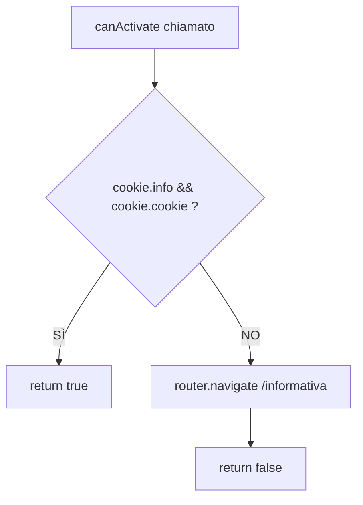

# drunk-io — Analisi Frontend Dettagliata

> **Versione**: 1.0  
> **Data**: 2025  
> **Stack**: Angular 15, Bootstrap Italia 2.6.1, Chart.js, ngx-cookie-service  
> **Riferimento**: `docs/requirements/drunk-io-frontend-requirements.md`, `docs/architecture/drunk-io-system-architecture.md`

---

## 1. Information Architecture (Struttura Navigazione)

```
drunk-io SPA
├── /#/informativa          [sempre accessibile — CookieComponent]
├── /#/faq                  [sempre accessibile — FaqComponent]
├── /#/contatti             [sempre accessibile — ContattiComponent]
└── /#/ [ContentComponent — richiede InformativaGuard]
    ├── /#/ [HomeComponent — richiede ProfiloGuard]
    │   ├── CalcoloAlcolemicoComponent (stato: selezione bevande)
    │   └── RisultatoAlcolemicoComponent (stato: risultato)
    ├── /#/profilo/:id      [ProfiloComponent — crea id=0, modifica id≠0]
    ├── /#/profili          [ProfiliComponent]
    └── /#/chart            [ChartComponent]
```

**Navigazione tra sezioni** (navbar Bootstrap Italia):
- Home (calcolo) → sempre presente
- Profili → link a `/#/profili`
- Storico → link a `/#/chart`
- FAQ → link a `/#/faq`
- Contatti → link a `/#/contatti`

**Breadcrumb**: non necessario (SPA flat, massimo 2 livelli)

---

## 2. Component Tree

```mermaid
graph TD
    APP[AppComponent<br/>root]

    APP --> CONT[ContentComponent<br/>layout shell<br/>InformativaGuard]
    APP --> COOK[CookieComponent<br/>/#/informativa]
    APP --> FAQ[FaqComponent<br/>/#/faq]
    APP --> CONT2[ContattiComponent<br/>/#/contatti]

    CONT --> NAV[NavbarComponent<br/>Bootstrap Italia]
    CONT --> ROUTER1[router-outlet<br/>child routes]

    ROUTER1 --> HOME[HomeComponent<br/>/#/<br/>ProfiloGuard]
    ROUTER1 --> PROF[ProfiloComponent<br/>/#/profilo/:id]
    ROUTER1 --> PROFL[ProfiliComponent<br/>/#/profili]
    ROUTER1 --> CHART[ChartComponent<br/>/#/chart]

    HOME --> CALC[CalcoloAlcolemicoComponent<br/>@Input tabella, show<br/>@Output tassoOut]
    HOME --> RIS[RisultatoAlcolemicoComponent<br/>@Input tasso, sanzioni<br/>@Output back]

    COOK --> CS1[CookieDrunkService]
    HOME --> CS2[CookieDrunkService]
    HOME --> API[APIMFApiImplService]
    CALC --> CS3[CookieDrunkService]
    PROF --> CS4[CookieDrunkService]
    PROFL --> CS5[CookieDrunkService]
    PROFL --> MS[ModalDrunkService]
    CHART --> CS6[CookieDrunkService]

    subgraph Lib["_lib (shared)"]
        TS[DrunkLibToastService]
        MS[ModalDrunkService]
        TH[THEME_COLORS_ENUM]
    end
```

---

## 3. State Management Analysis

### 3.1 Stato Persistente (Cookie)
```
Cookie 'info'               boolean — flag accettazione informativa
Cookie 'cookie'             boolean — flag consenso cookie
Cookie 'users'              JSON(User[]) — profili utente con storico bevute[]
Cookie 'profiloSelezionato' string (uuid) — id profilo attivo

TTL: 30 giorni
Gestione: CookieDrunkService (ngx-cookie-service)
Limite: ~4KB per cookie — RISCHIO CRITICO per 'users'
```

### 3.2 Stato In-Memory (BehaviorSubject)
```typescript
// CookieDrunkService
profiloCorrente$: BehaviorSubject<User|null>
// Emette il profilo attivo a tutti i subscriber
// Aggiornato da: setProfiloSelezionato(), setUser(), deleteUser()
```

**Subscriber attesi**:
- `HomeComponent` — usa profilo per passarlo a `CalcoloAlcolemicoComponent`
- `NavbarComponent` — mostra nome utente corrente
- `ChartComponent` — legge `bevute[]` del profilo attivo

### 3.3 Stato Locale ai Componenti
```
HomeComponent:
    tabellaAlcolemica: TabellaAlcolemica[]
    sanzioni: Pena[]
    tassoCalcolato: number
    showRisultato: boolean
    isLoading: boolean

CalcoloAlcolemicoComponent:
    bevandeSel: Drink[]     // lista bevande selezionate
    stomacoPieno: boolean   // stato stomaco

ProfiloComponent:
    profiloForm: FormGroup  // ReactiveForm
    pesiDisponibili: number[] // aggiornato al cambio sesso

ChartComponent:
    filtroGiorni: 7 | 31
    chartInstance: Chart    // riferimento Chart.js
```

### 3.4 Flusso Dati Stato

```
Azione Utente
    ↓
Componente Smart (aggiorna stato locale)
    ↓
CookieDrunkService (persiste su cookie + aggiorna BehaviorSubject)
    ↓
BehaviorSubject.next(newValue)
    ↓
Tutti i subscriber ricevono aggiornamento (async pipe)
    ↓
Angular Change Detection aggiorna la view
```

---

## 4. Routing Analysis

### 4.1 Tabella Rotte

| Path | Componente | Guards | Params | Note |
|---|---|---|---|---|
| `informativa` | `CookieComponent` | — | — | Accessibile sempre |
| `faq` | `FaqComponent` | — | — | Accessibile sempre |
| `contatti` | `ContattiComponent` | — | — | Accessibile sempre |
| `` (root) | `ContentComponent` | `InformativaGuard` | — | Shell con router-outlet figlio |
| `` (child) | `HomeComponent` | `ProfiloGuard` | — | Calcolo BAC |
| `profilo/:id` | `ProfiloComponent` | — | `id: string` | 0=nuovo, uuid=modifica |
| `profili` | `ProfiliComponent` | — | — | Lista profili |
| `chart` | `ChartComponent` | — | — | Grafico storico |

### 4.2 Logica Guard InformativaGuard



### 4.3 Logica Guard ProfiloGuard

```mermaid
flowchart TD
    A[canActivate chiamato] --> B{getUsers().length > 0 ?}
    B -->|NO| C[router.navigate /profilo/0]
    C --> D[return false]
    B -->|SÌ| E{getProfiloSelezionato() != null ?}
    E -->|NO| F[router.navigate /profili]
    F --> G[return false]
    E -->|SÌ| H[return true]
```

### 4.4 Redirect Logic Summary
```
Primo accesso:  /#/ → /#/informativa → /#/ → /#/profilo/0 → /#/
Senza selezione: /#/ → /#/profili → /#/
Accesso normale: /#/ → HomeComponent direttamente
```

---

## 5. Data Flow Analysis

### 5.1 Props Down (Input)
```
HomeComponent
    │
    ├──@Input tabella──→ CalcoloAlcolemicoComponent
    │   (TabellaAlcolemica[])
    │
    ├──@Input show──────→ CalcoloAlcolemicoComponent
    │   (boolean)
    │
    ├──@Input tabella──→ RisultatoAlcolemicoComponent
    │   (Pena[] — sanzioni)
    │
    └──@Input tasso────→ RisultatoAlcolemicoComponent
        (number — BAC calcolato)
```

### 5.2 Events Up (Output)
```
CalcoloAlcolemicoComponent
    └──@Output tassoOut──→ HomeComponent
        (EventEmitter<number>)

RisultatoAlcolemicoComponent
    └──@Output back──────→ HomeComponent
        (EventEmitter<void>)
```

### 5.3 Servizi (Side Effects)
```
CalcoloAlcolemicoComponent
    └──salvaAndamento()──→ CookieDrunkService──→ Cookie 'users'

ProfiloComponent
    ├──setUser()─────────→ CookieDrunkService──→ Cookie 'users'
    └──setProfiloSel()───→ CookieDrunkService──→ Cookie 'profiloSel'
                                           └──→ BehaviorSubject

ProfiliComponent
    ├──deleteUser()──────→ CookieDrunkService──→ Cookie 'users'
    └──setProfiloSel()───→ CookieDrunkService──→ Cookie + BehaviorSubject

ChartComponent
    └──updateUser()──────→ CookieDrunkService──→ Cookie 'users'
        (cancella bevute[])
```

### 5.4 HTTP Data Flow (APIMFApiImplService)
```
APP_INITIALIZER
    └──ConfigService──→ GET config.json──→ apiBase configurato

HomeComponent.ngOnInit()
    ├──recuperaTabAlcolemicaUsingGET()──→ GET {apiBase}/tabella_alcolemica.json
    │   └──subscribe → tabellaAlcolemica[] salvato in componente
    └──recuperaSanzioniUsingGET()──→ GET {apiBase}/sanzioni.json
        └──subscribe → sanzioni[] salvato in componente
```

---

## 6. Accessibilità: Gap Attuali vs WCAG 2.1 AA

| Gap ID | Area | Descrizione Gap | Criterio WCAG | Severità |
|---|---|---|---|---|
| A11Y-GAP-01 | Grafico Chart.js | Canvas non ha alternativa testuale accessibile; i dati non sono leggibili da screen reader | 1.1.1 Non-text Content | ALTA |
| A11Y-GAP-02 | Toast dinamici | `DrunkLibToastService` potrebbe non usare `aria-live` per annunciare messaggi | 4.1.3 Status Messages | ALTA |
| A11Y-GAP-03 | Modal ModalDrunkService | Focus trap non documentato; comportamento Escape non verificato | 2.1.1 Keyboard | ALTA |
| A11Y-GAP-04 | Navigazione programmatica | Focus non gestito esplicitamente dopo redirect router → utente può perdere il contesto | 2.4.3 Focus Order | MEDIA |
| A11Y-GAP-05 | Form calcolo | Toggle "stomaco pieno/vuoto" potrebbe non avere una label associata correttamente | 3.3.2 Labels | MEDIA |
| A11Y-GAP-06 | Colori fasce BAC | I colori semantici (verde/rosso) usati senza alternativa testuale violano "colore non unico indicatore" | 1.4.1 Use of Color | MEDIA |
| A11Y-GAP-07 | Contrasto tema | Colori custom del tema (`THEME_COLORS_ENUM`) non verificati per contrasto 4.5:1 | 1.4.3 Contrast | MEDIA |
| A11Y-GAP-08 | Input quantità | Campo numerico senza `aria-label` esplicita se abbinato solo a placeholder | 3.3.2 Labels | BASSA |

### 6.1 Raccomandazioni per Chiusura Gap

- **A11Y-GAP-01**: Aggiungere `aria-label` al `<canvas>` + tabella dati nascosta con `class="sr-only"` per screen reader
- **A11Y-GAP-02**: Usare `aria-live="polite"` o `"assertive"` nei toast; verificare implementazione `DrunkLibToastService`
- **A11Y-GAP-03**: Implementare focus trap in `ModalDrunkService` (CDK Trap Focus di Angular Material o soluzione custom)
- **A11Y-GAP-04**: Dopo router.navigate(), sposta il focus sul primo elemento focusabile del nuovo componente
- **A11Y-GAP-06**: Affiancare al colore un'icona + testo (es. "⚠️ Fascia ATTENZIONE") per ogni fascia BAC

---

## 7. Performance Analysis

### 7.1 Bundle e Lazy Loading

| Modulo | Lazy Loading | Impatto |
|---|---|---|
| `ChartModule` | Raccomandato (Chart.js è pesante ~200KB) | ALTO |
| `ProfiloModule` | Raccomandato | MEDIO |
| `ProfiliModule` | Raccomandato | MEDIO |
| `CookieModule` | Non prioritario (accesso frequente primo avvio) | BASSO |
| `FaqModule` | Raccomandato | BASSO |
| `ContattiModule` | Raccomandato | BASSO |

### 7.2 Opportunità Ottimizzazione

| Ottimizzazione | Impatto Atteso |
|---|---|
| `ChangeDetectionStrategy.OnPush` per Dumb Components | Riduzione cycle change detection |
| `trackBy` nelle `*ngFor` liste bevande e profili | Riduzione DOM re-rendering |
| `async pipe` per BehaviorSubject (vs. subscribe manual) | Prevenzione memory leak |
| Preloading strategy PWA per JSON statici | Funzionamento offline istantaneo |
| Font Bootstrap Italia: subset o preload | Riduzione FOUT (Flash of Unstyled Text) |

### 7.3 PWA Caching Analysis

| Risorsa | Strategia consigliata | Nota |
|---|---|---|
| SPA Shell (index.html, main.js) | `prefetch` + `cacheFirst` | Core dell'app |
| `tabella_alcolemica.json` | `cacheFirst` | Dati non cambiano frequentemente |
| `sanzioni.json` | `cacheFirst` | Dati non cambiano frequentemente |
| `config.json` | `networkFirst` | Può cambiare a ogni deploy |
| Bootstrap Italia CSS/JS | `cacheFirst` | Asset stabili |
| Font | `cacheFirst` | Asset stabili |

---

## 8. UX Flows per Feature Principale

### 8.1 Flusso Primo Utilizzo (Happy Path)
```
Apertura app
    → Schermata informativa (automatica)
    → [Legge, clicca "Accetto"]
    → Form creazione profilo (automatico)
    → [Inserisce nome, sesso, peso — clicca "Salva"]
    → Schermata calcolo BAC
    → [Seleziona bevande, quantità, stomaco]
    → [Clicca "Calcola"]
    → Schermata risultato BAC + sanzioni
    → [Clicca "Nuovo calcolo"]
    → Schermata calcolo BAC (reset)
```

### 8.2 Flusso Consulta Storico
```
Dalla navbar → click "Storico"
    → Grafico 7 giorni
    → [Toggle "31 giorni"]
    → Grafico 31 giorni
    → [Eventuale "Cancella storico" → conferma]
    → Grafico vuoto
```

### 8.3 Flusso Cambio Profilo
```
Dalla navbar → click "Profili"
    → Lista profili (profilo attivo evidenziato)
    → [Clicca su altro profilo → "Seleziona"]
    → Redirect home con nuovo profilo attivo
```

---

## 9. Raccomandazioni Tecniche

| Priorità | Raccomandazione | Motivazione |
|---|---|---|
| ALTA | Aggiungere `catchError` in `APIMFApiImplService` | Feedback utente su errori caricamento JSON |
| ALTA | Implementare `ChangeDetectionStrategy.OnPush` su `CalcoloAlcolemicoComponent` e `RisultatoAlcolemicoComponent` | Performance |
| ALTA | Audit accessibilità con axe-core o Lighthouse | Chiusura gap WCAG |
| ALTA | Limite storico `bevute[]` (es. max 100 record) o migrazione a localStorage | Prevenzione overflow cookie |
| MEDIA | Lazy loading per `ChartModule` | Riduzione bundle iniziale (Chart.js ~200KB) |
| MEDIA | Aggiungere `trackBy` in `*ngFor` per lista profili e lista bevande | Performance DOM |
| MEDIA | Usare `async pipe` per sottoscrizioni BehaviorSubject | Prevenzione memory leak |
| BASSA | Aggiungere `ngsw-config.json` aggiornato con strategia caching esplicita per JSON | PWA reliability |
| BASSA | Valutare tabella accessibile come alternativa al grafico Chart.js | WCAG 1.1.1 |

---

*Documento prodotto da analisi codebase. Versione: 1.0 — Data: 2025*
