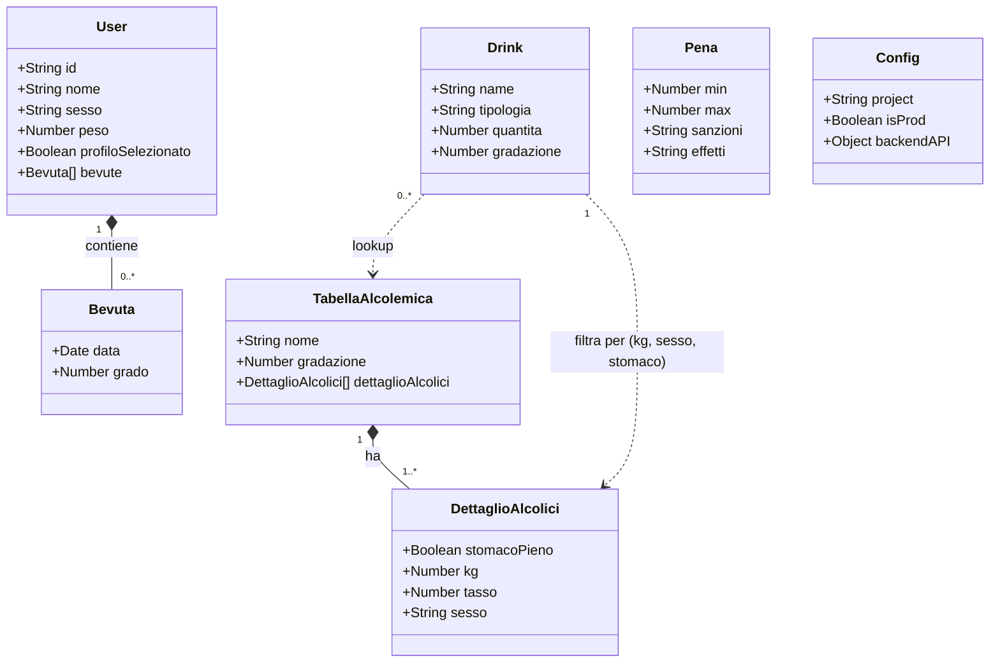

# drunk-io — Domain Model

> **Versione**: 1.0  
> **Data**: 2025  
> **Scope**: Frontend-only SPA Angular 15  
> **Riferimento**: `docs/requirements/drunk-io-codebase-baseline.md`, `docs/requirements/drunk-io-requirements.md`

---

## 1. Executive Summary

**drunk-io** è una SPA Angular 15 frontend-only. Non avendo un backend, i "bounded context" descrivono le aree funzionali della singola applicazione piuttosto che microservizi distribuiti. Il modello di dominio è quindi un **domain model per SPA monolitica**, con separazione logica delle responsabilità tra i moduli Angular.

Lo storage di persistenza è il **cookie browser** (tramite `CookieDrunkService`). Lo stato in-memoria è gestito tramite **BehaviorSubject** (pattern reactive). I dati di riferimento (lookup table BAC, sanzioni) sono file JSON statici.

---

## 2. Domini di Business

### 2.1 Dominio: Identità Utente (ProfiloContext)
Gestisce l'identità degli utenti che usano l'app. Supporta multi-profilo per consentire a più persone di condividere la stessa installazione.

**Responsabilità**:
- Creazione, modifica, eliminazione profili
- Selezione del profilo attivo
- Persistenza su cookie locale
- Notifica reattiva del profilo corrente

**Entità chiave**: `User`, cookie `users`, cookie `profiloSelezionato`

### 2.2 Dominio: Calcolo Alcolemico (CalcoloContext)
Nucleo funzionale dell'app. Gestisce la selezione delle bevande, il recupero dei dati dalla lookup table e il calcolo del BAC.

**Responsabilità**:
- Caricamento `tabella_alcolemica.json`
- Selezione interattiva delle bevande (tipo, quantità)
- Indicazione stato stomaco
- Algoritmo lookup + somma BAC
- Salvataggio risultato nello storico

**Entità chiave**: `TabellaAlcolemica`, `DettaglioAlcolici`, `Drink`

### 2.3 Dominio: Sanzioni (SanzioniContext)
Gestisce la presentazione delle conseguenze legali e fisiologiche corrispondenti a un BAC calcolato.

**Responsabilità**:
- Caricamento `sanzioni.json`
- Ricerca fascia di sanzione per BAC calcolato (`min ≤ BAC < max`)
- Visualizzazione effetti e sanzioni

**Entità chiave**: `Pena`

### 2.4 Dominio: Storico e Analisi (StoricoContext)
Gestisce la persistenza e la visualizzazione dello storico delle bevute nel tempo.

**Responsabilità**:
- Lettura storico `bevute[]` dal profilo
- Filtraggio per periodo (7gg / 31gg)
- Rendering grafico lineare (Chart.js)
- Cancellazione storico

**Entità chiave**: `bevute[]` (array inline in `User`)

### 2.5 Dominio: Privacy e Consenso (PrivacyContext)
Gestisce il flusso di accettazione obbligatoria dell'informativa prima dell'accesso alle funzionalità principali.

**Responsabilità**:
- Verifica accettazione informativa (InformativaGuard)
- Salvataggio consenso su cookie
- Revoca consenso (cancellazione tutti i cookie)

**Entità chiave**: cookie `info`, cookie `cookie`

### 2.6 Dominio: Informativo (InfoContext)
Gestisce i contenuti statici informativi dell'app.

**Responsabilità**:
- FAQ statiche
- Pagina contatti
- Schermata presentazione app

**Entità chiave**: contenuto statico (nessun modello dati)

---

## 3. Bounded Contexts (SPA)

### 3.1 ProfiloContext

```
┌─────────────────────────────────────────────────────┐
│  ProfiloContext                                     │
│                                                     │
│  Aggregate Root: User                               │
│  ├── id: uuid v4                                    │
│  ├── nome: string                                   │
│  ├── sesso: 'M' | 'F'                               │
│  ├── peso: number (range discreti)                  │
│  ├── profiloSelezionato: boolean                    │
│  └── bevute: [{data, grado}][] (storico inline)     │
│                                                     │
│  Services: CookieDrunkService                       │
│  Storage: Cookie 'users', Cookie 'profiloSel'       │
│  State: BehaviorSubject<User|null>                  │
└─────────────────────────────────────────────────────┘
```

### 3.2 CalcoloContext

```
┌─────────────────────────────────────────────────────┐
│  CalcoloContext                                     │
│                                                     │
│  Value Objects:                                     │
│  ├── TabellaAlcolemica                              │
│  │   ├── nome: string                              │
│  │   ├── gradazione: number                        │
│  │   └── dettaglioAlcolici: DettaglioAlcolici[]    │
│  │       ├── stomacoPieno: boolean                 │
│  │       ├── kg: number                            │
│  │       ├── tasso: number                         │
│  │       └── sesso: string                         │
│  └── Drink (selezione utente)                       │
│      ├── name: string                              │
│      ├── tipologia: 'Alcolico'|'Super alcolico'    │
│      ├── quantita: number                          │
│      └── gradazione: number                        │
│                                                     │
│  Services: APIMFApiImplService, ConfigService       │
│  Algoritmo: Σ(tasso[peso,sesso,stomaco] × quantità) │
└─────────────────────────────────────────────────────┘
```

### 3.3 SanzioniContext

```
┌─────────────────────────────────────────────────────┐
│  SanzioniContext                                    │
│                                                     │
│  Value Object: Pena                                 │
│  ├── min: number  (BAC minimo fascia)               │
│  ├── max: number  (BAC massimo fascia)              │
│  ├── sanzioni: string                               │
│  └── effetti: string                                │
│                                                     │
│  Services: APIMFApiImplService                      │
│  Lookup: min ≤ BAC_calcolato < max                  │
└─────────────────────────────────────────────────────┘
```

### 3.4 StoricoContext

```
┌─────────────────────────────────────────────────────┐
│  StoricoContext                                     │
│                                                     │
│  Entity (inline in User):                           │
│  bevuta {                                           │
│    data: Date                                       │
│    grado: number  (BAC registrato)                  │
│  }                                                  │
│                                                     │
│  Services: CookieDrunkService                       │
│  Dipende da: ProfiloContext (User attivo)           │
│  Visualizzazione: ChartComponent (Chart.js)         │
└─────────────────────────────────────────────────────┘
```

### 3.5 PrivacyContext

```
┌─────────────────────────────────────────────────────┐
│  PrivacyContext                                     │
│                                                     │
│  State: cookie.info: boolean                        │
│         cookie.cookie: boolean                      │
│                                                     │
│  Guard: InformativaGuard                            │
│  Services: CookieDrunkService                       │
│  Reset: deleteAllCookies()                          │
└─────────────────────────────────────────────────────┘
```

---

## 4. Context Map

```mermaid
graph TD
    subgraph SPA["drunk-io SPA (Angular 15)"]
        PC[ProfiloContext<br/>User, CookieDrunkService]
        CC[CalcoloContext<br/>TabellaAlcolemica, Drink]
        SC[SanzioniContext<br/>Pena, sanzioni.json]
        ST[StoricoContext<br/>bevute[], ChartComponent]
        PR[PrivacyContext<br/>InformativaGuard, consenso]
        IN[InfoContext<br/>FAQ, Contatti, Presentazione]
    end

    PR -->|"Gate: accesso consentito solo con consenso"| PC
    PR -->|"Gate: accesso consentito solo con consenso"| CC
    PC -->|"Profilo attivo (peso, sesso)"| CC
    CC -->|"BAC calcolato"| SC
    CC -->|"Salva bevuta (data, grado)"| ST
    ST -->|"Legge bevute[]"| PC
    IN -.->|"Navigazione autonoma (no dipendenze)"| PR

    EXT_TAB[(tabella_alcolemica.json)]
    EXT_SAN[(sanzioni.json)]
    EXT_CONF[(config.json)]

    CC -->|"HTTP GET"| EXT_TAB
    SC -->|"HTTP GET"| EXT_SAN
    CC -->|"apiBase"| EXT_CONF
```

---

## 5. Entity & Aggregate Models



---

## 6. Decisioni di Design

### DD-01: Cookie come unico storage
**Decisione**: Tutti i dati utente sono persistiti esclusivamente su cookie browser (ngx-cookie-service).  
**Motivazione**: Privacy-by-design — nessun dato trasmesso a server. Semplicità di implementazione per app FE-only.  
**Trade-off**: Limite di 4KB per cookie limita la crescita dello storico `bevute[]`. [GAP-01]

### DD-02: Lookup Table anziché Formula di Widmark
**Decisione**: Il calcolo BAC usa una lookup table precompilata (`tabella_alcolemica.json`) invece della formula di Widmark diretta.  
**Motivazione**: Maggiore semplicità di manutenzione dei dati. Possibilità di calibrare i valori senza modificare il codice.  
**Trade-off**: La qualità del risultato dipende interamente dalla correttezza dei dati JSON. [GAP-04]

### DD-03: Hash Routing
**Decisione**: `useHash: true` nel router Angular.  
**Motivazione**: Compatibilità con nginx senza configurazione `try_files` specifica per ogni rotta.  
**Trade-off**: URL meno leggibili (es. `/#/profilo/1`).

### DD-04: BehaviorSubject per stato in-memory
**Decisione**: Il profilo corrente è esposto come `BehaviorSubject<User|null>` in `CookieDrunkService`.  
**Motivazione**: Pattern reactive Angular — i componenti si sottoscrivono e ricevono aggiornamenti automatici.  
**Trade-off**: Nessuno stato globale centralizzato (no NgRx), ma per la complessità attuale è sufficiente.

### DD-05: Config runtime via APP_INITIALIZER
**Decisione**: `ConfigService` carica `config.json` prima del bootstrap Angular.  
**Motivazione**: Permette di iniettare configurazioni differenti per ambiente (dev/staging/prod) senza rebuild dell'immagine Docker.  
**Allineamento**: Consigliato per architetture containerizzate K8s.

---

*Documento prodotto da analisi codebase. Versione: 1.0 — Data: 2025*
