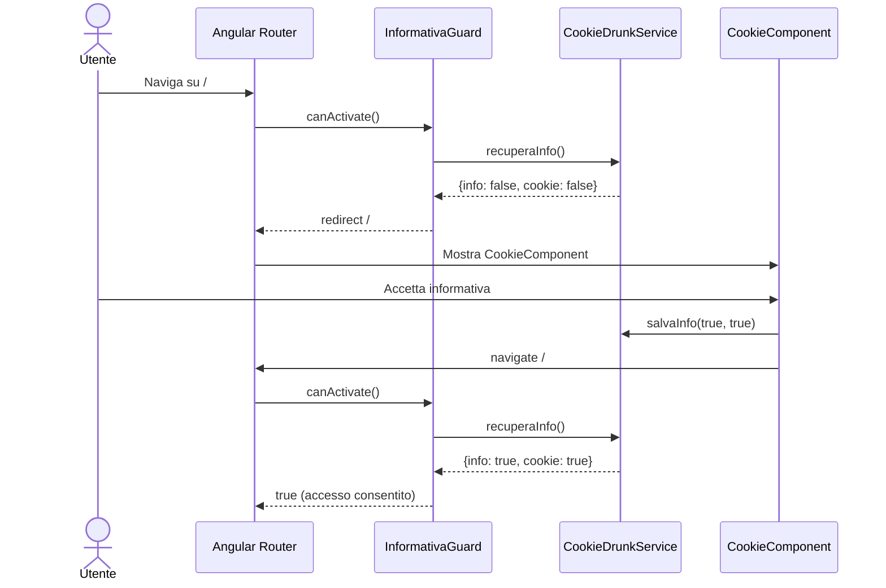
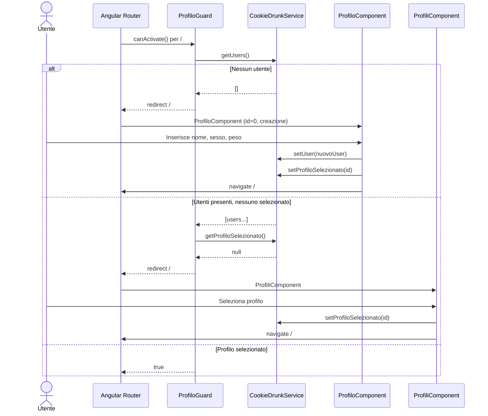
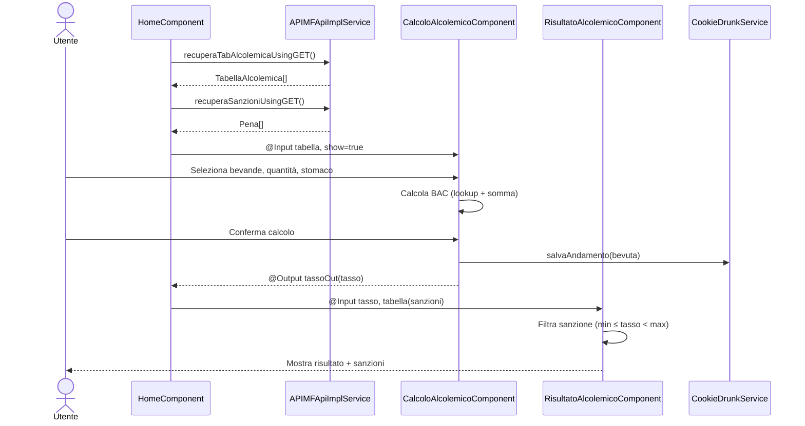
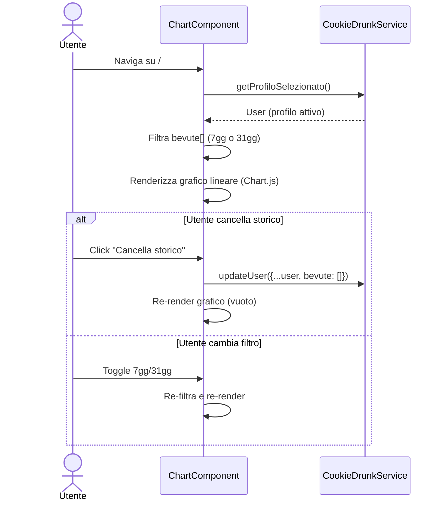
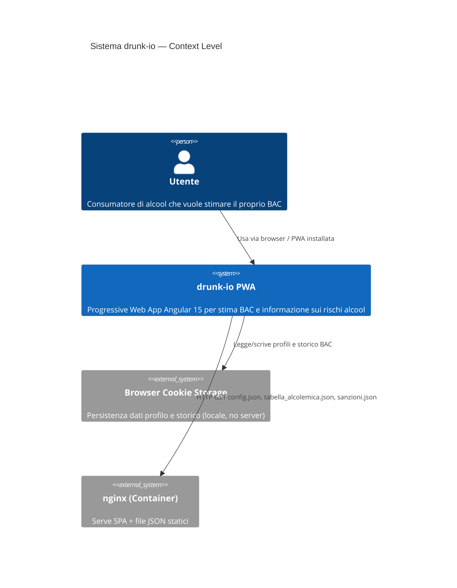
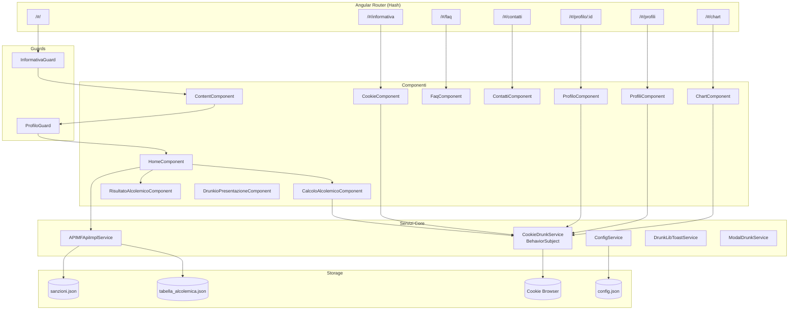
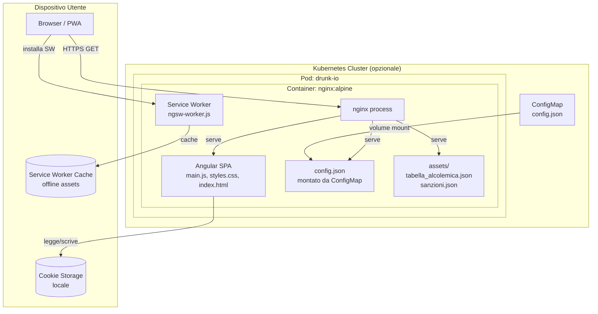

# drunk-io — System Architecture

> **Versione**: 1.0  
> **Data**: 2025  
> **Scope**: Frontend-only SPA Angular 15  
> **Riferimento**: `docs/architecture/drunk-io-domain-model.md`, `docs/requirements/drunk-io-codebase-baseline.md`

---

## 1. Executive Summary

**drunk-io** è una **SPA (Single Page Application) monolitica Angular 15** con le seguenti caratteristiche architetturali:

- **Routing**: hash-based (`useHash: true`) per compatibilità nginx
- **Storage**: cookie browser come unico layer di persistenza (ngx-cookie-service, 30gg TTL)
- **Dati di riferimento**: file JSON statici (`tabella_alcolemica.json`, `sanzioni.json`) serviti da nginx
- **Stato in-app**: BehaviorSubject reattivo in `CookieDrunkService`
- **Configurazione runtime**: `config.json` caricato tramite `APP_INITIALIZER` prima del bootstrap
- **Deploy**: Docker container con nginx — containerizzabile per K8s
- **PWA**: service worker Angular per caching e installabilità offline
- **Nessun backend**: zero endpoint API con logica server-side

[CODICE: `src/app/app-routing.module.ts`], [CODICE: `src/app/_core/services/config.service.ts`]

---

## 2. Inventario Componenti e Moduli

### 2.1 Moduli Angular

| Modulo | Tipo | Responsabilità |
|---|---|---|
| `AppModule` | Root | Bootstrap, routing globale, provider APP_INITIALIZER |
| `ContentModule` | Feature | Layout principale con router-outlet figlio, guard InformativaGuard |
| `HomeModule` | Feature (lazy) | Calcolo BAC, visualizzazione risultato |
| `ProfiloModule` | Feature (lazy) | Creazione/modifica profilo |
| `ProfiliModule` | Feature (lazy) | Lista e selezione profili |
| `ChartModule` | Feature (lazy) | Grafico storico BAC |
| `CookieModule` | Feature | Informativa cookie/privacy |
| `FaqModule` | Feature | FAQ statiche |
| `ContattiModule` | Feature | Pagina contatti |
| `DrunkioPresentazioneModule` | Feature | Landing/presentazione |
| `_CoreModule` | Core | Servizi singleton (CookieDrunkService, APIMFApiImplService, ConfigService), guard, modelli |
| `_LibModule` | Shared | Toast service, Modal service, THEME_COLORS_ENUM |

### 2.2 Servizi Applicativi

| Servizio | Pattern | Scope |
|---|---|---|
| `CookieDrunkService` | Singleton + BehaviorSubject | Root (providedIn: 'root') |
| `APIMFApiImplService` | Singleton HTTP | Root |
| `ConfigService` | Singleton + APP_INITIALIZER | Root |
| `DrunkLibToastService` | Utility | Root |
| `ModalDrunkService` | Utility | Root |

### 2.3 Guards

| Guard | Tipo | Protegge |
|---|---|---|
| `InformativaGuard` | CanActivate | `ContentComponent` e tutto il sotto-albero di routing |
| `ProfiloGuard` | CanActivate | `HomeComponent` |

---

## 3. Stile Architetturale

### 3.1 SPA Monolitica con Feature Modules
L'app segue il pattern **Feature Module** di Angular: ogni funzionalità è racchiusa in un modulo dedicato con i propri componenti, routing e dipendenze. I servizi condivisi risiedono nel `_CoreModule`.

### 3.2 Smart/Dumb Components
- **Smart Components** (es. `HomeComponent`): conoscono i servizi, orchestrano i dumb components, gestiscono lo stato
- **Dumb Components** (es. `CalcoloAlcolemicoComponent`, `RisultatoAlcolemicoComponent`): ricevono dati via `@Input` ed emettono eventi via `@Output`

### 3.3 Gestione Stato
```
Cookie (persistenza 30gg)
    ↕ ngx-cookie-service
CookieDrunkService
    ↕ BehaviorSubject<User|null>
Componenti Angular (async pipe / subscribe)
```

Nessuno stato globale centralizzato (no NgRx, no Akita). La semplicità del dominio giustifica questa scelta.

### 3.4 Data Flow
```
JSON Statici (nginx)
    → APIMFApiImplService (HTTP GET)
    → HomeComponent (smart)
    → CalcoloAlcolemicoComponent (@Input tabella)
    → [Utente interagisce]
    → Algoritmo BAC (lookup + somma)
    → CookieDrunkService.salvaAndamento()
    → Cookie 'users' aggiornato
    → tassoOut (@Output EventEmitter)
    → HomeComponent mostra RisultatoAlcolemicoComponent
    → RisultatoAlcolemicoComponent (@Input tasso, sanzioni)
```

---

## 4. Deployment

### 4.1 Struttura Container

```
Docker Image: drunk-io
└── Base Image: nginx:alpine
    └── /usr/share/nginx/html/
        ├── index.html             (entry point SPA Angular)
        ├── main.*.js              (bundle applicazione)
        ├── polyfills.*.js
        ├── styles.*.css
        ├── ngsw.json              (service worker manifest)
        ├── ngsw-worker.js         (service worker)
        ├── config.json            (configurazione runtime — montabile come ConfigMap)
        ├── assets/
        │   ├── tabella_alcolemica.json
        │   └── sanzioni.json
        └── nginx.conf             (configurazione nginx)
```

### 4.2 Configurazione nginx
- Serve la SPA Angular in modalità hash routing (nessuna configurazione `try_files` necessaria)
- Gestisce le richieste agli asset statici JSON
- Headers CORS e CSP configurabili

### 4.3 Configurazione Runtime (config.json)
```json
{
  "project": "Drunk.io",
  "isProd": true,
  "backendAPI": {
    "apiBase": "/assets"
  }
}
```
Il file può essere montato come **ConfigMap Kubernetes** per differenziare ambienti senza rebuild.

### 4.4 Pattern K8s Consigliato
- **entrypoint.sh** + env vars da ConfigMap/Secret (per produzione con eventuali segreti)
- ConfigMap volume mount per `config.json` (per configurazione non-secret)

---

## 5. Flussi Critici

### 5.1 Flusso Accettazione Informativa



### 5.2 Flusso Selezione/Creazione Profilo



### 5.3 Flusso Calcolo BAC



### 5.4 Flusso Visualizzazione Storico



---

## 6. Diagramma C4 — Context Level



---

## 7. Diagramma Componenti



---

## 8. Diagramma Deployment



---

## 9. Cross-Cutting Concerns

### 9.1 Accessibilità (WCAG 2.1 AA)
- **Obbligatoria** per tutti i componenti
- Bootstrap Italia 2.6.1 fornisce componenti già parzialmente conformi
- Richiede audit manuale per: focus management nelle navigazioni programmatiche, labels ARIA su form, contrasto colori tema personalizzato
- `DrunkLibToastService` e `ModalDrunkService` devono gestire l'accessibilità delle notifiche dinamiche (live regions ARIA)

### 9.2 Privacy-by-Design
- Zero dati trasmessi a server esterni [README]
- Cookie con scadenza 30gg
- `deleteAllCookies()` per diritto all'oblio
- Nessun tracker, nessuna analytics

### 9.3 PWA
- Service worker Angular (`@angular/service-worker`)
- `ngsw-config.json` definisce strategia caching
- App installabile su mobile e desktop
- Funzionamento offline dopo primo caricamento

### 9.4 Disclaimer Legale
- Visibile in ogni schermata di calcolo e risultato
- Obbligatorio per conformità all'uso responsabile dell'app

---

*Documento prodotto da analisi codebase. Versione: 1.0 — Data: 2025*
