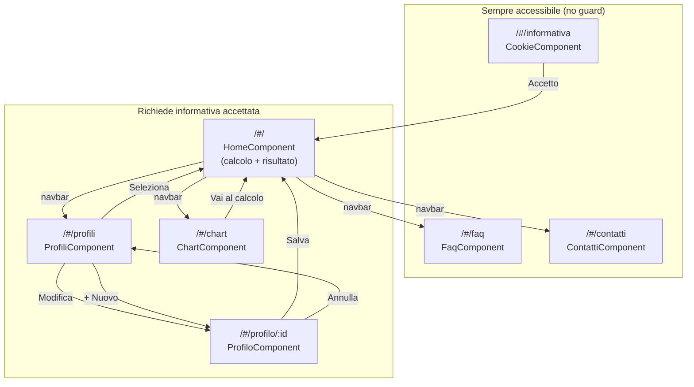

# drunk-io — Prototipo Frontend (Wireframe)

> **Versione**: 1.0  
> **Data**: 2025  
> **Stack**: Angular 15, Bootstrap Italia 2.6.1  
> **Riferimento**: `docs/analysis/drunk-io-frontend-use-cases.md`, `docs/requirements/drunk-io-frontend-requirements.md`

---

## Convenzioni Wireframe

```
[Bottone primario]       = elemento interattivo cliccabile (azione principale)
{Bottone secondario}     = elemento interattivo cliccabile (azione secondaria)
<input>                  = campo di input
[▼ Select]               = dropdown di selezione
(● Radio)  (○ Radio)     = radio button
[☑ Check]                = checkbox
═══════                  = separatore orizzontale
│                        = separatore verticale
┌─┐ └─┘                  = bordi card/container
░░░                      = area placeholder (immagine/grafico)
~                        = testo descrittivo
```

---

## 1. Schermata: Informativa Cookie (`/#/informativa`)

### Mobile (320–575px)

```
┌─────────────────────────────────────────────┐
│  🍺 drunk.io                                │
│─────────────────────────────────────────────│
│                                             │
│  INFORMATIVA SULLA PRIVACY E COOKIE         │
│  ─────────────────────────────────────────  │
│                                             │
│  drunk.IO è un'applicazione con il solo     │
│  scopo di informare e sensibilizzare la     │
│  gente sui pericoli dell'alcool.            │
│                                             │
│  Utilizzo dei cookie                        │
│  ─────────────────                          │
│  Questa applicazione utilizza cookie        │
│  esclusivamente per salvare i tuoi dati     │
│  localmente sul tuo dispositivo.            │
│  Nessun dato viene trasmesso a server       │
│  esterni.                                   │
│                                             │
│  Dati raccolti:                             │
│  • Profilo utente (nome, sesso, peso)       │
│  • Storico BAC                              │
│  • Preferenze app                           │
│                                             │
│  I cookie hanno durata 30 giorni.           │
│                                             │
│  ⚠️ I risultati BAC sono puramente          │
│  indicativi e non attendibili.              │
│                                             │
│─────────────────────────────────────────────│
│  [      ACCETTO      ]                      │
│─────────────────────────────────────────────│
│  {FAQ}          {Contatti}                  │
└─────────────────────────────────────────────┘
```

### Desktop (992px+)

```
┌─────────────────────────────────────────────────────────────────┐
│  🍺 drunk.io                              FAQ  |  Contatti      │
│─────────────────────────────────────────────────────────────────│
│                                                                 │
│              ┌─────────────────────────────┐                   │
│              │  INFORMATIVA PRIVACY COOKIE  │                   │
│              │  ─────────────────────────  │                   │
│              │  ~ testo informativa ~       │                   │
│              │  ~ testo informativa ~       │                   │
│              │  ~ testo informativa ~       │                   │
│              │                             │                   │
│              │  ⚠️ Disclaimer legale        │                   │
│              │                             │                   │
│              │       [    ACCETTO    ]      │                   │
│              │  {Gestisci preferenze}       │                   │
│              └─────────────────────────────┘                   │
│                                                                 │
└─────────────────────────────────────────────────────────────────┘
```

### Componenti presenti
- Logo app
- Testo informativa (statico)
- Bottone "Accetto" (primario, full-width mobile)
- Link FAQ, Contatti (footer)
- Sezione "Revoca consenso" (visibile solo se già accettato)

### Navigazione
- **Da dove**: primo accesso, redirect da InformativaGuard
- **Dove posso andare**: `/#/` (dopo accettazione), `/#/faq`, `/#/contatti`

### Accessibilità WCAG 2.1 AA
- `<main>` landmark per il contenuto
- `<h1>` "Informativa Privacy e Cookie"
- Bottone con testo chiaro, touch target 44×44px minimo
- Nessun elemento solo decorativo con significato

---

## 2. Schermata: Home / Calcolo Alcolemico (`/#/`)

### Mobile (320–575px)

```
┌─────────────────────────────────────────────┐
│  🍺 drunk.io              [≡ Menu]          │
│  👤 Mario (70kg M)                          │
│─────────────────────────────────────────────│
│                                             │
│  CALCOLA IL TUO BAC                         │
│                                             │
│  STOMACO                                    │
│  [● Pieno]      [○ Vuoto]                   │
│                                             │
│  ─────────────────────────────────────────  │
│  BEVANDE SELEZIONATE                        │
│  ─────────────────────────────────────────  │
│  ┌─────────────────────────────────────┐    │
│  │ Birra 33cl (Alcolico - 4.5°)       │    │
│  │         [−] │ 1 │ [+]  [× Rimuovi] │    │
│  ├─────────────────────────────────────┤    │
│  │ Vino rosso (Alcolico - 12°)        │    │
│  │         [−] │ 1 │ [+]  [× Rimuovi] │    │
│  └─────────────────────────────────────┘    │
│                                             │
│  [+ Aggiungi bevanda]  {🗑 Svuota lista}    │
│                                             │
│  ═══════════════════════════════════════    │
│  [        CALCOLA IL MIO BAC        ]       │
│  ═══════════════════════════════════════    │
│                                             │
│  ⚠️ I risultati sono indicativi e non       │
│  attendibili. Solo a scopo informativo.     │
│                                             │
└─────────────────────────────────────────────┘
```

### Desktop (992px+)

```
┌─────────────────────────────────────────────────────────────────┐
│  🍺 drunk.io    Home  │ Profili  │ Storico  │ FAQ  │ Contatti  │
│─────────────────────────────────────────────────────────────────│
│  👤 Mario • 70kg • M                                            │
│─────────────────────────────────────────────────────────────────│
│                                                                 │
│  CALCOLA IL TUO BAC STIMATO                                     │
│                                                                 │
│  ┌──────────────────────────────┬────────────────────────────┐  │
│  │  STOMACO                     │  BEVANDE SELEZIONATE       │  │
│  │  [● Pieno]  [○ Vuoto]        │  ┌──────────────────────┐  │  │
│  │                              │  │ Birra 33cl           │  │  │
│  │  [+ Aggiungi bevanda]        │  │ [−] │ 1 │ [+] [× ]  │  │  │
│  │  {🗑 Svuota lista}           │  ├──────────────────────┤  │  │
│  │                              │  │ Vino rosso           │  │  │
│  │                              │  │ [−] │ 1 │ [+] [× ]  │  │  │
│  │                              │  └──────────────────────┘  │  │
│  └──────────────────────────────┴────────────────────────────┘  │
│                                                                 │
│              [       CALCOLA IL MIO BAC       ]                 │
│                                                                 │
│  ⚠️ Risultati indicativi — Non attendibili                      │
└─────────────────────────────────────────────────────────────────┘
```

### Componenti presenti
- Navbar Bootstrap Italia (responsive)
- Profilo attivo (nome, peso, sesso) in header
- Toggle stomaco pieno/vuoto
- Lista bevande selezionate con quantità ±
- Bottone "+ Aggiungi bevanda" (apre dropdown/modal selezione)
- Bottone "Svuota lista"
- Bottone "Calcola" (CTA principale, disabilitato se lista vuota)
- Disclaimer

### Navigazione
- **Da dove**: redirect da ProfiloGuard (profilo attivo)
- **Dove posso andare**: risultato BAC (embedded), `/#/profili`, `/#/chart`, `/#/faq`, `/#/contatti`

### Comportamento Responsive
- Mobile: layout single column, lista bevande scrollabile (max-height 250px)
- Desktop: layout two-column (stomaco/azioni | lista bevande)
- Navbar: hamburger su mobile, orizzontale su desktop

### Accessibilità WCAG 2.1 AA
- `<fieldset>` + `<legend>` per stomaco e lista bevande
- Input quantità con aria-label "Quantità [nome bevanda]"
- Bottone "Calcola" con `aria-disabled` quando lista vuota
- Disclaimer in `<aside aria-label="Avviso legale">`

---

## 3. Schermata: Risultato Alcolemico (embedded in Home, `/#/`)

### Mobile (320–575px)

```
┌─────────────────────────────────────────────┐
│  🍺 drunk.io              [≡ Menu]          │
│  👤 Mario (70kg M)                          │
│─────────────────────────────────────────────│
│                                             │
│  IL TUO TASSO ALCOLEMICO STIMATO            │
│                                             │
│  ┌─────────────────────────────────────┐    │
│  │                                     │    │
│  │        ⚠️  0,82 g/L                │    │
│  │                                     │    │
│  │    FASCIA: ATTENZIONE               │    │
│  │    ████████████░░░░░░  [arancio]    │    │
│  └─────────────────────────────────────┘    │
│                                             │
│  EFFETTI FISIOLOGICI                        │
│  ─────────────────────                      │
│  • Stato di euforia                         │
│  • Riduzione tempi di reazione              │
│  • Alterazione della visione                │
│                                             │
│  SANZIONI LEGALI (art. 186 CdS)             │
│  ─────────────────────────────              │
│  Sanzione da €800 a €3.200                  │
│  Sospensione patente 6-12 mesi              │
│  Ritiro patente                             │
│                                             │
│  ═══════════════════════════════════════    │
│  ⚠️ DISCLAIMER: Dati puramente indicativi.  │
│  Non attendibili. Non sostituiscono         │
│  strumenti ufficiali.                       │
│  ═══════════════════════════════════════    │
│                                             │
│  [← Nuovo calcolo]                          │
│                                             │
└─────────────────────────────────────────────┘
```

### Desktop (992px+)

```
┌─────────────────────────────────────────────────────────────────┐
│  🍺 drunk.io    Home  │ Profili  │ Storico  │ FAQ  │ Contatti  │
│─────────────────────────────────────────────────────────────────│
│                                                                 │
│  RISULTATO BAC STIMATO — Mario                                  │
│  ─────────────────────────────────────────────────────────────  │
│                                                                 │
│  ┌────────────────────────────────────────────────────────┐    │
│  │   ⚠️  TASSO ALCOLEMICO STIMATO:  0,82 g/L             │    │
│  │   ████████████░░░░  FASCIA ATTENZIONE (0.5 - 0.8 g/L) │    │
│  └────────────────────────────────────────────────────────┘    │
│                                                                 │
│  ┌──────────────────────────┬─────────────────────────────┐    │
│  │  EFFETTI FISIOLOGICI     │  SANZIONI LEGALI (art.186)  │    │
│  │  ───────────────────     │  ─────────────────────────  │    │
│  │  • Stato di euforia      │  • Multa €800 - €3.200      │    │
│  │  • Riduzione reazione    │  • Sospensione patente      │    │
│  │  • Visione alterata      │  • Ritiro patente           │    │
│  └──────────────────────────┴─────────────────────────────┘    │
│                                                                 │
│  ⚠️ DISCLAIMER: I dati sono puramente indicativi e non         │
│  attendibili. Non sostituiscono strumenti ufficiali.           │
│                                                                 │
│                     [← Nuovo calcolo]                          │
└─────────────────────────────────────────────────────────────────┘
```

### Componenti presenti
- BAC calcolato (valore prominente)
- Indicatore fascia con colore + icona + testo
- Barra di progresso visiva (Bootstrap Italia progressbar)
- Sezione effetti fisiologici
- Sezione sanzioni legali
- Disclaimer obbligatorio (sempre visibile)
- Bottone "Nuovo calcolo"

### Navigazione
- **Da dove**: emissione evento `tassoOut` da CalcoloAlcolemicoComponent
- **Dove posso andare**: calcolo BAC (click "Nuovo calcolo" → back event)

### Colori Fasce
| BAC | Colore | Classe Bootstrap |
|---|---|---|
| 0.00 | Verde | `bg-success` |
| 0.01–0.49 | Giallo | `bg-warning` |
| 0.50–0.79 | Arancio | `bg-warning` (variant) |
| ≥ 0.80 | Rosso | `bg-danger` |

### Accessibilità WCAG 2.1 AA
- Risultato BAC annunciato con `aria-live="assertive"` al mount
- Colori SEMPRE con testo alternativo (icona + etichetta scritta)
- Disclaimer in elemento dedicato con `role="note"` o `<aside>`

---

## 4. Schermata: Crea/Modifica Profilo (`/#/profilo/:id`)

### Mobile (320–575px)

```
┌─────────────────────────────────────────────┐
│  🍺 drunk.io              [≡ Menu]          │
│─────────────────────────────────────────────│
│                                             │
│  CREA IL TUO PROFILO                        │
│  (oppure: MODIFICA PROFILO)                 │
│                                             │
│  Nome *                                     │
│  <────────────────────────────────>         │
│  [× messaggio errore se vuoto]              │
│                                             │
│  Sesso *                                    │
│  (● Maschio M)   (○ Femmina F)              │
│                                             │
│  Peso corporeo *                            │
│  [▼ Seleziona il tuo peso (kg)...]          │
│     ├ 50 kg                                 │
│     ├ 60 kg                                 │
│     ├ 70 kg  ← (lista aggiornata per sesso) │
│     ├ 80 kg                                 │
│     └ 90 kg                                 │
│                                             │
│  * Campi obbligatori                        │
│                                             │
│  ═══════════════════════════════════════    │
│  [         SALVA PROFILO          ]         │
│  ═══════════════════════════════════════    │
│  {Annulla}  ← solo in modalità modifica     │
│                                             │
└─────────────────────────────────────────────┘
```

### Desktop (768px+)

```
┌─────────────────────────────────────────────────────────────────┐
│  🍺 drunk.io    Home  │ Profili  │ Storico  │ FAQ  │ Contatti  │
│─────────────────────────────────────────────────────────────────│
│                                                                 │
│         ┌──────────────────────────────────────┐               │
│         │  CREA IL TUO PROFILO                  │               │
│         │  ──────────────────────────────────   │               │
│         │  Nome *                               │               │
│         │  <──────────────────────────────>     │               │
│         │                                       │               │
│         │  Sesso *                              │               │
│         │  (● M)  (○ F)                        │               │
│         │                                       │               │
│         │  Peso *                               │               │
│         │  [▼ Seleziona peso (kg)]              │               │
│         │                                       │               │
│         │  [SALVA]              {Annulla}        │               │
│         └──────────────────────────────────────┘               │
└─────────────────────────────────────────────────────────────────┘
```

### Componenti presenti
- Input testo "Nome" (con validazione)
- Radio "Sesso" M/F
- Select "Peso" (range discreti, aggiornato al cambio sesso)
- Messaggi errore inline
- Bottone "Salva profilo" / "Salva modifiche" (CTA)
- Bottone "Annulla" (solo modalità modifica)

### Navigazione
- **Da dove**: ProfiloGuard (nessun profilo), click "+ Nuovo profilo" da Profili
- **Dove posso andare**: `/#/` (dopo salvataggio), `/#/profili` (Annulla)

### Comportamento Responsive
- Mobile: form full-width, bottoni full-width e stacked
- Desktop: form max-width 480px centrato, bottoni inline

### Accessibilità WCAG 2.1 AA
- `<fieldset>` + `<legend>` per sesso e peso
- `aria-required="true"` su campi obbligatori
- `aria-describedby` per messaggi errore
- Bottone "Salva" con `aria-disabled` quando form invalido

---

## 5. Schermata: Lista Profili (`/#/profili`)

### Mobile (320–575px)

```
┌─────────────────────────────────────────────┐
│  🍺 drunk.io              [≡ Menu]          │
│─────────────────────────────────────────────│
│                                             │
│  I TUOI PROFILI                             │
│  [+ Aggiungi nuovo profilo]                 │
│                                             │
│  ┌─────────────────────────────────────┐    │
│  │  Mario                   ✅ ATTIVO  │    │
│  │  Maschio · 70 kg                    │    │
│  │  ─────────────────────────────────  │    │
│  │  {✏ Modifica}    {🗑 Elimina}       │    │
│  └─────────────────────────────────────┘    │
│                                             │
│  ┌─────────────────────────────────────┐    │
│  │  Giulia                             │    │
│  │  Femmina · 55 kg                    │    │
│  │  ─────────────────────────────────  │    │
│  │  [Seleziona]                        │    │
│  │  {✏ Modifica}    {🗑 Elimina}       │    │
│  └─────────────────────────────────────┘    │
│                                             │
└─────────────────────────────────────────────┘
```

### Desktop (992px+)

```
┌─────────────────────────────────────────────────────────────────┐
│  🍺 drunk.io    Home  │ Profili  │ Storico  │ FAQ  │ Contatti  │
│─────────────────────────────────────────────────────────────────│
│                                                                 │
│  I TUOI PROFILI                    [+ Aggiungi nuovo profilo]   │
│  ──────────────────────────────────────────────────────────     │
│                                                                 │
│  ┌─────────────────┐  ┌─────────────────┐  ┌────────────────┐ │
│  │ Mario    ✅ATTIVO│  │ Giulia          │  │  + Nuovo       │ │
│  │ M · 70kg        │  │ F · 55kg        │  │  profilo       │ │
│  │                 │  │                 │  │                │ │
│  │ {Modifica}      │  │ [Seleziona]     │  │                │ │
│  │ {Elimina}       │  │ {Modifica}      │  │                │ │
│  │                 │  │ {Elimina}       │  │                │ │
│  └─────────────────┘  └─────────────────┘  └────────────────┘ │
│                                                                 │
└─────────────────────────────────────────────────────────────────┘
```

### Modale Eliminazione

```
┌─────────────────────────────────────┐
│  Elimina profilo                    │
│  ─────────────────────────────────  │
│  Sei sicuro di voler eliminare      │
│  il profilo Mario?                  │
│  Questa azione eliminerà anche lo   │
│  storico BAC associato.             │
│  L'operazione è irreversibile.      │
│                                     │
│  {Annulla}          [🗑 Elimina]    │
└─────────────────────────────────────┘
```

### Componenti presenti
- Lista card profili (Bootstrap Italia)
- Badge "Attivo" sul profilo selezionato
- Bottone "Seleziona" (solo su profili non attivi)
- Bottone "Modifica"
- Bottone "Elimina" (con modale conferma)
- Bottone "+ Aggiungi nuovo profilo" (CTA)
- Stato empty: messaggio + CTA creazione

### Navigazione
- **Da dove**: ProfiloGuard, navbar "Profili"
- **Dove posso andare**: `/#/` (selezione profilo), `/#/profilo/0` (nuovo), `/#/profilo/:id` (modifica)

### Comportamento Responsive
- Mobile: 1 colonna, card full-width
- Desktop: 2-3 colonne grid, card larghezza fissa

### Accessibilità WCAG 2.1 AA
- `role="list"` su contenitore, `role="listitem"` per ogni card
- `aria-label="Elimina profilo Mario"` sul bottone elimina
- Badge "Attivo": testo visibile + `<span class="sr-only">profilo attualmente attivo</span>`
- Focus trap nella modale eliminazione

---

## 6. Schermata: Grafico Storico (`/#/chart`)

### Mobile (320–575px)

```
┌─────────────────────────────────────────────┐
│  🍺 drunk.io              [≡ Menu]          │
│─────────────────────────────────────────────│
│                                             │
│  STORICO BAC — Mario                        │
│                                             │
│  [7 giorni]   [31 giorni]                   │
│                        {🗑 Cancella storico} │
│                                             │
│  ┌─────────────────────────────────────┐    │
│  │                                     │    │
│  │   1.0 │      ·                      │    │
│  │   0.8 │          ·                  │    │
│  │   0.6 │    ·          ·             │    │
│  │   0.4 │                  ·          │    │
│  │   0.2 │                             │    │
│  │   0.0 └────────────────────────     │    │
│  │        Lun  Mar  Mer  Gio  Ven      │    │
│  │                                     │    │
│  └─────────────────────────────────────┘    │
│                                             │
│  Tasso alcolemico (g/L) negli ultimi 7gg    │
│                                             │
│  ─ ─ ─ ─ Legge italiana: limite 0.5 g/L    │
│                                             │
└─────────────────────────────────────────────┘
```

### Stato Empty (nessun dato)

```
┌─────────────────────────────────────────────┐
│  STORICO BAC — Mario                        │
│                                             │
│  [7 giorni]   [31 giorni]                   │
│                                             │
│  ┌─────────────────────────────────────┐    │
│  │                                     │    │
│  │     📊  Nessun dato disponibile     │    │
│  │                                     │    │
│  │  Esegui un calcolo BAC per vedere   │    │
│  │  il tuo storico qui.                │    │
│  │                                     │    │
│  │       [Vai al calcolo →]            │    │
│  └─────────────────────────────────────┘    │
└─────────────────────────────────────────────┘
```

### Modale Cancella Storico

```
┌─────────────────────────────────────┐
│  Cancella storico BAC               │
│  ─────────────────────────────────  │
│  Sei sicuro di voler cancellare     │
│  tutto lo storico BAC di Mario?     │
│  L'operazione è IRREVERSIBILE.      │
│                                     │
│  {Annulla}    [🗑 Cancella storico] │
└─────────────────────────────────────┘
```

### Desktop (992px+)

```
┌─────────────────────────────────────────────────────────────────┐
│  🍺 drunk.io    Home  │ Profili  │ Storico  │ FAQ  │ Contatti  │
│─────────────────────────────────────────────────────────────────│
│                                                                 │
│  STORICO BAC — Mario                {🗑 Cancella storico}      │
│  [7 giorni] [31 giorni]                                         │
│  ──────────────────────────────────────────────────────────     │
│                                                                 │
│  ┌──────────────────────────────────────────────────────────┐  │
│  │  1.0 │                                                   │  │
│  │  0.8 │          ·                                        │  │
│  │  0.6 │    ·          ·      ·                            │  │
│  │  0.4 │                          ·                        │  │
│  │  0.2 │  ─ ─ ─ ─ ─ ─ ─ ─ ─ ─ ─ ─ ─ ─ (limite 0.5 g/L) │  │
│  │  0.0 └──────────────────────────────────────────────     │  │
│  │       Lun   Mar   Mer   Gio   Ven   Sab   Dom            │  │
│  └──────────────────────────────────────────────────────────┘  │
│                                                                 │
│  Tasso alcolemico (g/L) negli ultimi 7 giorni                   │
└─────────────────────────────────────────────────────────────────┘
```

### Componenti presenti
- Intestazione con nome profilo
- Toggle filtro 7gg/31gg (Bootstrap Italia btn-group)
- Bottone "Cancella storico"
- Canvas Chart.js (grafico lineare responsivo)
- Legenda e etichette assi
- Linea tratteggiata limite legale (0.5 g/L)
- Stato empty con CTA

### Navigazione
- **Da dove**: navbar "Storico"
- **Dove posso andare**: `/#/` (link "Vai al calcolo")

### Comportamento Responsive
- Mobile: grafico full-width, aspect ratio 1:1
- Desktop: grafico full-width container, aspect ratio 2:1

### Accessibilità WCAG 2.1 AA
- `<canvas aria-label="Grafico storico BAC">` + tabella nascosta dati
- Toggle filtro come radiogroup con `aria-checked`
- Dopo cancellazione: `aria-live="polite"` annuncia "Storico cancellato"

---

## 7. Schermata: FAQ (`/#/faq`)

### Mobile (320–575px)

```
┌─────────────────────────────────────────────┐
│  🍺 drunk.io              [≡ Menu]          │
│─────────────────────────────────────────────│
│                                             │
│  DOMANDE FREQUENTI (FAQ)                    │
│                                             │
│  ┌─────────────────────────────────────┐    │
│  │ ▼ Come viene calcolato il BAC?     │    │
│  │ ─────────────────────────────────  │    │
│  │ Il BAC viene calcolato tramite      │    │
│  │ una tabella di riferimento in       │    │
│  │ base a: bevanda, quantità, peso,    │    │
│  │ sesso e stato dello stomaco.        │    │
│  └─────────────────────────────────────┘    │
│                                             │
│  ┌─────────────────────────────────────┐    │
│  │ ► I dati sono attendibili?          │    │
│  └─────────────────────────────────────┘    │
│                                             │
│  ┌─────────────────────────────────────┐    │
│  │ ► I miei dati sono al sicuro?       │    │
│  └─────────────────────────────────────┘    │
│                                             │
│  ┌─────────────────────────────────────┐    │
│  │ ► Come elimino tutti i miei dati?   │    │
│  └─────────────────────────────────────┘    │
│                                             │
│  ┌─────────────────────────────────────┐    │
│  │ ► L'app funziona offline?           │    │
│  └─────────────────────────────────────┘    │
│                                             │
└─────────────────────────────────────────────┘
```

### Componenti presenti
- Titolo `<h1>` "Domande Frequenti"
- Accordion Bootstrap Italia (ogni domanda espandibile)
- Navbar di navigazione

### Navigazione
- **Da dove**: navbar, link da Informativa
- **Dove posso andare**: qualsiasi sezione via navbar
- **Nota**: accessibile anche senza informativa accettata

### Accessibilità WCAG 2.1 AA
- `aria-expanded` su ogni bottone accordion
- `aria-controls` che punta al pannello corrispondente
- Navigazione tastiera: Tab per spostamento, Enter/Space per espansione

---

## 8. Schermata: Contatti (`/#/contatti`)

### Mobile (320–575px)

```
┌─────────────────────────────────────────────┐
│  🍺 drunk.io              [≡ Menu]          │
│─────────────────────────────────────────────│
│                                             │
│  CONTATTI                                   │
│                                             │
│  ┌─────────────────────────────────────┐    │
│  │                                     │    │
│  │  👤 Buonsanto Vito                  │    │
│  │  Maintainer & Developer             │    │
│  │  ✉️ [vito@esempio.it]              │    │
│  │  🐙 [GitHub: @vbuonsanto]           │    │
│  │                                     │    │
│  └─────────────────────────────────────┘    │
│                                             │
│  ┌─────────────────────────────────────┐    │
│  │                                     │    │
│  │  👤 Favia Fabrizio                  │    │
│  │  Maintainer & Developer             │    │
│  │  ✉️ [fabrizio@esempio.it]          │    │
│  │  🐙 [GitHub: @ffavia]               │    │
│  │                                     │    │
│  └─────────────────────────────────────┘    │
│                                             │
│  ─────────────────────────────────────────  │
│  Segnala un problema o suggerisci           │
│  un miglioramento aprendo una              │
│  [issue su GitHub →]                        │
│                                             │
└─────────────────────────────────────────────┘
```

### Componenti presenti
- Card per ogni maintainer (nome, ruolo, contatti)
- Link email e GitHub accessibili
- Link a repository GitHub per issue

### Navigazione
- **Da dove**: navbar, link da Informativa
- **Nota**: accessibile senza informativa accettata

### Accessibilità WCAG 2.1 AA
- Link email con testo descrittivo (non solo indirizzo)
- Link GitHub con `aria-label="Profilo GitHub di Buonsanto Vito"`
- Card semantica con `<article>` per ogni maintainer

---

## Riepilogo Navigation Map



---

*Documento prodotto da analisi codebase. Versione: 1.0 — Data: 2025*
